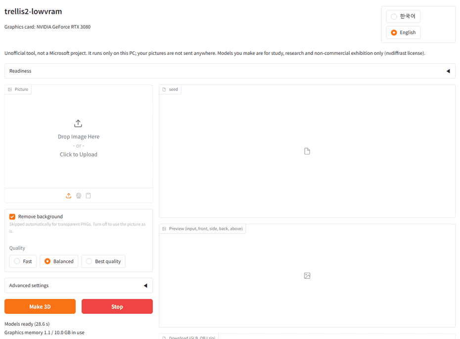

# trellis2-lowvram

> **Unofficial tool. This is not a Microsoft project** and is not affiliated with or endorsed by Microsoft.
> It wraps [microsoft/TRELLIS.2](https://github.com/microsoft/TRELLIS.2) (MIT) without changing the model.

[한국어 README](README.ko.md)

Turn one picture into a textured 3D model (GLB) on your own PC. This tool installs and runs the
same TRELLIS.2 4B image-to-3D model on 16GB consumer NVIDIA GPUs (RTX 30/40/50) with a one-click
installer, on Windows and Ubuntu.


> **Status: in development (milestone M3 of 4).** Install, PC check, command-line generation and
> the web interface work. Measured so far: an RTX 3080 10GB on Windows 11 and an
> RTX 4090 with a simulated 14.5 GiB cap ([benchmarks](docs/BENCHMARKS.md)). **No real 16GB card
> has been tested yet.** More results: [examples](docs/examples/README.md).

## Requirements

| | Needed | Notes |
|---|---|---|
| OS | Windows 10/11 or Ubuntu 22.04/24.04 | macOS is not supported |
| Graphics card | NVIDIA RTX 30, 40 or 50 series | RTX 20 and older, AMD and Intel are not supported |
| Graphics memory | 16GB | 12GB or less is experimental |
| RAM | 32GB recommended | 16GB may work |
| Disk | about 30GB free (estimate) | program and models |
| NVIDIA driver | 570 or newer | the installer tells you if it is too old |

You do **not** need to install Python, CUDA, Visual Studio or conda yourself.

## Install

1. Download this repository (green **Code** button, **Download ZIP**) and extract it to a short
   English path such as `C:\trellis2-lowvram`.
2. **Request DINOv3 access now**, because approval is done by people and can take hours to days:
   create a [Hugging Face account](https://huggingface.co/join), then submit the form on
   [facebook/dinov3-vitl16-pretrain-lvd1689m](https://huggingface.co/facebook/dinov3-vitl16-pretrain-lvd1689m).
3. Windows: double-click `install.bat`. Ubuntu: run `./install.sh`.
   The installer checks your PC first, then downloads everything into this folder.
   At the end it asks for a Hugging Face token ([create one](https://huggingface.co/settings/tokens), Read permission)
   and puts a **trellis2-lowvram** shortcut on the desktop.
   If DINOv3 is not approved yet, everything except the model files is installed; after the
   approval email, open the web interface and press **Download models**.
4. If something fails, the installer says what to check and prints the path of a log file.
   See [troubleshooting](docs/TROUBLESHOOTING.md), or attach the log to an issue.

To uninstall, delete the folder. To update, run `update.bat` / `./update.sh`.

### Sharing the models with a class (install without approval)

Once one person with DINOv3 approval (say, the teacher) has the models, students can install
without a token or approval of their own.

1. On the teacher's PC, in this folder, run `trellis2 share-models --open` (PowerShell:
   `.\trellis2 share-models --open`). It makes a `shared-models` folder (about 11GB with only
   512, about 16GB with 1024 too).
2. Give that whole folder to the students (USB stick or shared drive).
3. Each student puts `shared-models`, as it is, into their trellis2-lowvram folder and runs
   `install.bat`. The installer moves the models in, so the token step passes. Students who have
   already installed run `trellis2 import-models <folder>`.
   If it arrived as several zip parts (Google Drive does this), extract every part inside the same
   `shared-models` folder and put the files over 2GB that came separately (a number such as `-008`
   added to the name) there too, without renaming them. Anything still missing is named.

With all model files present, no Hugging Face token is needed to run. The DINOv3 License requires
a copy of the license with every copy of the weights: keep `DINOv3-LICENSE.md` in the folder.
Whoever receives it must follow the same terms (no military or weapons use, follow applicable
laws including trade controls, credit DINOv3 in publications).

## Check your PC

```
trellis2 doctor        # Windows, Command Prompt in this folder
.\trellis2 doctor      # Windows PowerShell (the default terminal on Windows 11)
./trellis2.sh doctor   # Ubuntu
```

`[FAIL]` lines tell you what is wrong and what to do.

## Make a model

**Web interface:** double-click the **trellis2-lowvram** desktop icon or `run.bat`
(Ubuntu: `./run.sh`). Your browser opens a local page: upload a picture (PNG, JPG, WEBP or iPhone
HEIC), pick a quality, press **Make 3D**, turn the model around, download GLB / OBJ.
Several seeds can be made at once and compared side by side; **Stop** ends a run after the
current step and keeps the models already finished. Korean / English switch at the top.
Opening it a second time reuses the running page instead of loading the models again.
The page stays on this PC (127.0.0.1); `run.bat --share` makes a public link only if you ask.
The rotatable 3D view needs a browser with WebGPU (current Chrome or Edge); preview images and
downloads work in any browser.



**Drag and drop (Windows):** drag one or more pictures onto `make3d.bat`. It makes a model for
each (balanced quality) and opens the result folder when done. Ubuntu: `./make3d.sh photo.jpg`.

**Command line:**

```
trellis2 generate photo.jpg                      # Windows (in this folder)
./trellis2.sh generate photo.jpg                 # Ubuntu
trellis2 generate photo.jpg --seeds 3            # three variations to choose from
trellis2 generate photo.jpg --preset quality     # texture 4096, more faces (slower)
```

Each run saves to its own folder `outputs/<date-time>/`: a `.glb` (with PBR materials) and an
`_obj` folder (OBJ + texture), plus a report of time and graphics memory per stage. If graphics memory runs out, it tells you
which stage failed and offers to retry with lower settings. The first run on a PC takes a few
extra minutes. See [tips for input images](docs/examples/README.md#tips-for-input-images--좋은-입력-이미지).

## License

Code in this repository: MIT. Model weights are not included; they are downloaded from their
official sources at install time. Some components have their own terms; in particular
**nvdiffrast, used to bake textures, allows non-commercial use only**, so models you make are for
study, research and non-commercial exhibition. Full list: [THIRD_PARTY_LICENSES.md](THIRD_PARTY_LICENSES.md).

## Problems

[docs/TROUBLESHOOTING.md](docs/TROUBLESHOOTING.md) (Korean and English) covers install failures,
DINOv3 access, a blank 3D view, slowness and out-of-memory.

## For developers and AI agents

Start with [HANDOFF.md](HANDOFF.md). Design notes: [docs/PLAN.md](docs/PLAN.md) (Korean).
