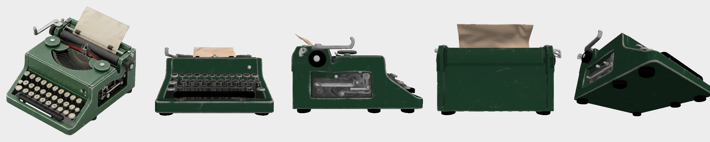
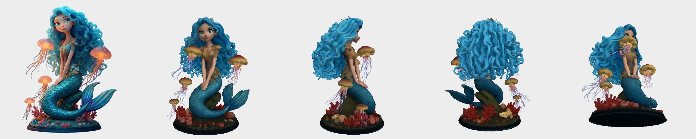

# trellis2-lowvram

> **Unofficial tool. This is not a Microsoft project** and is not affiliated with or endorsed by Microsoft.
> It wraps [microsoft/TRELLIS.2](https://github.com/microsoft/TRELLIS.2) (MIT) without changing the model.

[한국어 README](README.ko.md)

Turn one picture into a textured 3D model (GLB) on your own PC. This tool installs and runs the
same TRELLIS.2 4B image-to-3D model on 16GB consumer NVIDIA GPUs (RTX 30/40/50) with a one-click
installer, on Windows and Ubuntu.




> **Status: in development (milestone M3 of 4).** Install, PC check, command-line generation and
> the web interface work. Measured so far: an RTX 3080 10GB on Windows 11 and an
> RTX 4090 with a simulated 14.5 GiB cap ([benchmarks](docs/BENCHMARKS.md)). **No real 16GB card
> has been tested yet.** More results: [examples](docs/examples/README.md).

## Requirements

| | Needed | Notes |
|---|---|---|
| OS | Windows 10/11 or Ubuntu 22.04/24.04 | macOS is not supported |
| Graphics card | NVIDIA RTX 30, 40 or 50 series | RTX 20 and older, AMD and Intel are not supported |
| Graphics memory | 16GB | 12GB or less is experimental |
| RAM | 32GB recommended | 16GB may work |
| Disk | about 30GB free (estimate) | program and models |
| NVIDIA driver | 570 or newer | the installer tells you if it is too old |

You do **not** need to install Python, CUDA, Visual Studio or conda yourself.

## Install

1. Download this repository (green **Code** button, **Download ZIP**) and extract it to a short
   English path such as `C:\trellis2-lowvram`.
2. **Request DINOv3 access now**, because approval is done by people and can take hours to days:
   create a [Hugging Face account](https://huggingface.co/join), then submit the form on
   [facebook/dinov3-vitl16-pretrain-lvd1689m](https://huggingface.co/facebook/dinov3-vitl16-pretrain-lvd1689m).
3. Windows: double-click `install.bat`. Ubuntu: run `./install.sh`.
   The installer checks your PC first, then downloads everything into this folder.
   At the end it asks for a Hugging Face token ([create one](https://huggingface.co/settings/tokens), Read permission).
4. If something fails, the installer prints the path of a log file. Please attach it to an issue.

To uninstall, delete the folder. To update, run `update.bat` / `./update.sh`.

`TODO(screenshot)`: installer and PC check.

## Check your PC

```
trellis2 doctor        # Windows (in this folder)
./trellis2.sh doctor   # Ubuntu
```

`[FAIL]` lines tell you what is wrong and what to do.

## Make a model

**Web interface:** double-click `run.bat` (Ubuntu: `./run.sh`). Your browser opens a local page:
upload a picture, pick a quality, press **Make 3D**, turn the model around, download GLB / OBJ.
Several seeds can be made at once and compared side by side. Korean / English switch at the top.
The page stays on this PC (127.0.0.1); `run.bat --share` makes a public link only if you ask.
The rotatable 3D view needs a browser with WebGPU (current Chrome or Edge); preview images and
downloads work in any browser.

**Drag and drop (Windows):** drag one or more pictures onto `make3d.bat`. It makes a model for
each (balanced quality) and opens the `outputs` folder when done. Ubuntu: `./make3d.sh photo.jpg`.

**Command line:**

```
trellis2 generate photo.jpg                      # Windows (in this folder)
./trellis2.sh generate photo.jpg                 # Ubuntu
trellis2 generate photo.jpg --seeds 3            # three variations to choose from
trellis2 generate photo.jpg --preset quality     # texture 4096, more faces (slower)
```

Results go to `outputs/`: a `.glb` (with PBR materials) and an `_obj` folder (OBJ + texture),
plus a report of time and graphics memory per stage. If graphics memory runs out, it tells you
which stage failed and offers to retry with lower settings. The first run on a PC takes a few
extra minutes. See [tips for input images](docs/examples/README.md#tips-for-input-images--좋은-입력-이미지).

## License

Code in this repository: MIT. Model weights are not included; they are downloaded from their
official sources at install time. Some components have their own terms; in particular
**nvdiffrast, used to bake textures, allows non-commercial use only**, so models you make are for
study, research and non-commercial exhibition. A full list will be in `THIRD_PARTY_LICENSES.md`.

## For developers and AI agents

Start with [HANDOFF.md](HANDOFF.md). Design notes: [docs/PLAN.md](docs/PLAN.md) (Korean).
