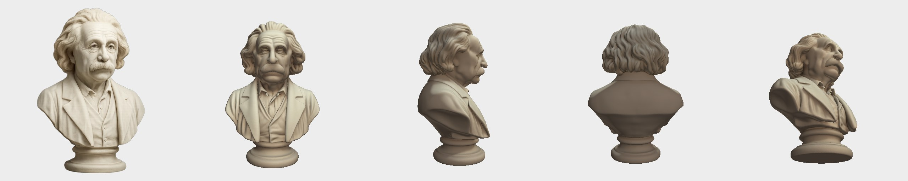
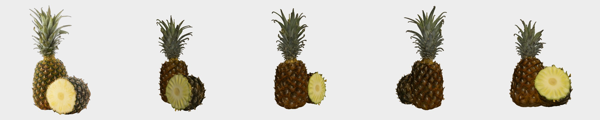
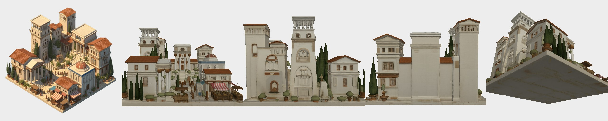
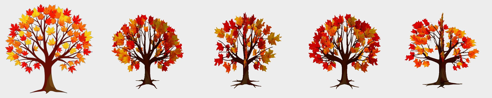
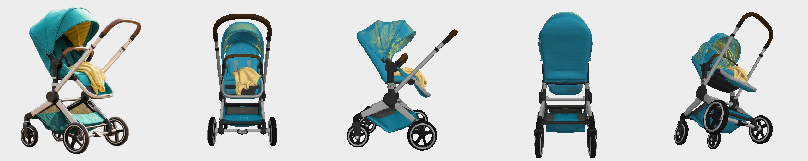
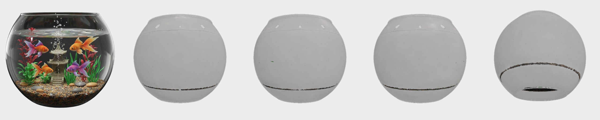

# Examples / 예시

Eight models made with this tool from TRELLIS.2's own sample images (MIT, `assets/example_image`),
chosen to show both what works and what is hard. Each picture: the input, then the generated
model from the front, side, back and above. Previews are a quick render of the base color
texture (`trellis2_lowvram.preview`), not a PBR render.

이 도구로 TRELLIS.2 기본 예시 이미지(MIT)에서 만든 모델 8개입니다. 잘되는 것과 어려운 것을 함께 골랐습니다.
그림마다 맨 왼쪽이 입력, 나머지가 만들어진 모델의 앞·옆·뒤·위입니다.

**Download the GLB files / GLB 내려받기:** [release `examples-v1`](https://github.com/joonhyungbae/trellis2-lowvram/releases/tag/examples-v1)
(20-32 MB each; open them in Blender, Windows 3D Viewer, or https://gltf-viewer.donmccurdy.com).

Settings: preset `balanced` (pipeline 512, 12 steps, texture 2048, 500k faces), seed 42,
RTX 4090 with a simulated 14.5 GiB cap (`scripts/make_examples.py`). Time excludes model loading.

| | Example | Time (s) | Peak VRAM (MiB) | Notes / 메모 |
|---|---|---:|---:|---|
|  | bust 흉상 | 38.1 | 2728 | Back of the head is invented plausibly. 보이지 않던 뒤통수도 자연스럽게 채움 |
|  | pineapple 파인애플 | 29.6 | 2790 | Organic texture holds up. 유기적인 표면이 잘 나옴 |
|  | typewriter 타자기 | 50.5 | 4146 | Hard surface and keys are clean; the hidden back is plain. 기계 면은 깔끔하고, 안 보이던 뒷면은 단순하게 채움 |
|  | village 마을 | 34.7 | 4604 | An isometric scene becomes a block; unseen sides are guessed. 아이소메트릭 장면은 한 덩어리가 되고 안 보이던 면은 추측 |
|  | maple 단풍나무 | 41.3 | 2950 | A flat illustration becomes a full tree with depth. 평면 일러스트가 두께 있는 나무가 됨 |
|  | stroller 유모차 | 45.2 | 3070 | Thin frame and wheels survive. 가는 프레임과 바퀴가 살아남음 |
|  | mermaid 인어 | 38.7 | 3608 | Translucent jellyfish kept (material set to BLEND). 반투명 해파리가 남음(재질을 BLEND 로 표시) |
|  | fishbowl 어항 | 52.9 | 6468 | **Limitation:** only the glass shell is made; the fish and plants inside are lost. **한계:** 유리 껍데기만 생기고 안의 물고기·수초는 사라짐 |

## Tips for input images / 좋은 입력 이미지

- One object, fully in frame, on a plain background (or a transparent PNG). 물체 하나가 잘리지 않고, 배경은 단순하게(또는 투명 PNG).
- Even lighting, no strong shadows; a slight three-quarter view shows more of the shape. 고른 조명, 강한 그림자 없이. 살짝 비스듬한 각도가 형태를 더 많이 보여 줌.
- At least 512 px on the short side. 짧은 변이 512px 이상.
- Avoid transparent containers and things seen through glass: the inside is not generated. 투명한 용기와 유리 너머의 물체는 피할 것. 안쪽은 만들어지지 않음.
- The side you cannot see is invented. If the back matters, generate several seeds and pick one. 보이지 않는 면은 지어냄. 뒷면이 중요하면 seed 를 여러 개 만들어 고를 것.
